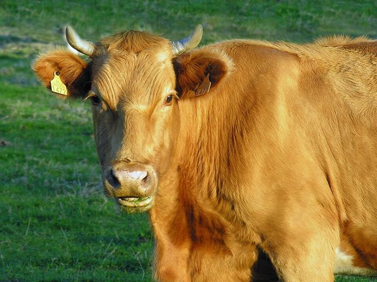
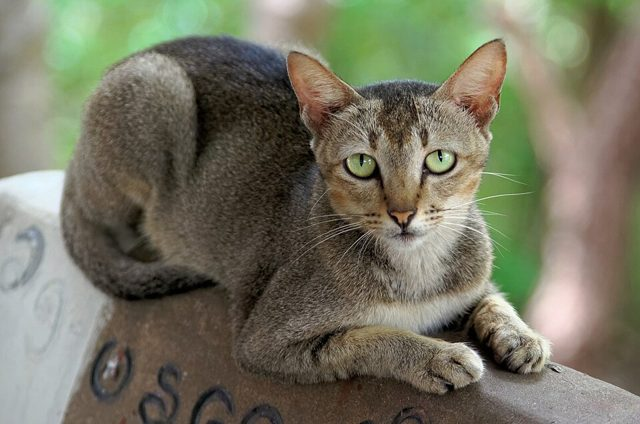

<p align="center">
  <picture>
    <source media="(prefers-color-scheme: dark)" srcset="assets/henkia-logo-white.png">
    
  </picture>
</p>

<h1 align="center">Embeddings multimodales</h1>

<p align="center">
  <b>Clasificar documentos por lo que dicen <i>y</i> por cómo se ven</b><br>
  AI Thinkers
</p>

<p align="center">
  
  
  
  
  
</p>

<p align="center">
  <a href="#-la-idea">La idea</a> ·
  <a href="#-resultado">Resultado</a> ·
  <a href="#-la-interfaz">La interfaz</a> ·
  <a href="#-empezar">Empezar</a> ·
  <a href="#-lo-que-nos-llevamos">Lo que nos llevamos</a> ·
  <a href="#-qué-hay-en-el-repositorio">Repositorio</a>
</p>

---

## 💡 La idea

> **Dos documentos pueden decir lo mismo y ser tipos distintos, o decir cosas
> distintas y ser el mismo tipo.** Esa diferencia está en la estructura de la
> página, no en las palabras.

El demo toma una carpeta con PDFs mezclados y nombres que no dicen nada
(`doc_001.pdf`, `doc_002.pdf`…), los agrupa **sin decirle cuántos tipos hay** y
deja una subcarpeta por grupo. Compara cuatro formas de representar cada
documento: dos que solo miran el texto, una que solo mira la página y la fusión
de texto y layout.

El corpus tiene 73 documentos de 8 tipos y dos pares diseñados como trampa:

| Trampa | Par | Quién cae |
|---|---|---|
| Mismo texto, layout distinto | `factura` en tabla y `factura_narrativa` redactada como carta | los modelos de texto |
| Mismo layout, texto distinto | `historia_clinica` y `formulario_afiliacion`, con la misma geometría de formulario | el modelo visual |

## 📊 Resultado

| Representación | Grupos que encuentra | ARI sin decirle cuántos tipos hay | ARI con k = 8 |
|---|:---:|:---:|:---:|
| Solo texto — TF-IDF léxico | 7 | 0.850 | 0.804 |
| Solo texto — embedding denso | 7 | 0.850 | 0.853 |
| Solo imagen / layout — CLIP | 6 | 0.731 | 0.833 |
| **Multimodal (texto + layout)** | **8** | **1.000** | **1.000** |

ARI = 1.0 es reproducir exactamente los 8 tipos reales. Sin decirles cuántos
tipos hay, los modelos de texto juntan la factura con la factura narrada y CLIP
junta la historia clínica con el formulario de afiliación. Solo la fusión
separa los dos pares a la vez.

> [!NOTE]
> El corpus no está en el repositorio: se genera en local con
> `generar_dataset.py`, y siempre sale igual. Las empresas, bancos, EPS y
> personas de los documentos son ficticios. Las figuras de la evaluación salen
> de `evaluar.py`.

## 💻 La interfaz

Una app en Streamlit que calcula los embeddings con
**Qwen/Qwen3-VL-Embedding-2B** servido en vLLM: texto, fotos y páginas de PDF
caen en el mismo espacio de 2048 dimensiones con norma 1.

| Pestaña | Qué hace |
|---|---|
| **Intro** | qué es un embedding multimodal: un texto, una foto y la página de un PDF entran al mismo modelo y sale un vector de cada uno |
| **Comparar archivos** | dos o tres archivos, sus vectores, los ángulos entre ellos y una proyección 3D sin distorsión |
| **Agrupar una carpeta** | agrupa todos los archivos por un punto de corte de coseno y crea una subcarpeta por grupo |
| **Comparar texto e imagen** | un texto escrito contra una imagen; con varias descripciones, cuál se le parece más |
| **Agrupar por texto** | cada archivo de una carpeta va al texto que más se le parece, si pasa el punto de corte |
| **Conclusiones** | lo que nos llevamos del demo |

Para las pestañas de imagen, el repositorio trae 30 fotos de vacas, gatos y
árboles de Wikimedia Commons, más una vaca y un gato negro sueltos. Con los
textos «un árbol», «una vaca» y «un gato», **Agrupar por texto** reparte las
32 fotos mezcladas sin un error: 10, 11 y 11.

<p align="center">
  
  
  
</p>

## 🚀 Empezar

```bash
cd demo-embeddings-multimodal

# entorno
uv venv --python 3.12 .venv
VIRTUAL_ENV=.venv uv pip install --torch-backend=auto \
  torch torchvision transformers sentence-transformers \
  scikit-learn matplotlib numpy pandas reportlab pymupdf pillow \
  streamlit plotly

# línea de comandos: generar el corpus y clasificarlo por umbral
cd src
../.venv/bin/python generar_dataset.py
../.venv/bin/python clasificar.py --barrido
../.venv/bin/python clasificar.py --umbral 0.825

# interfaz gráfica (necesita el modelo arriba en vLLM, http://localhost:8001)
cd ..
make desplegar      # abre http://localhost:8501
```

> [!TIP]
> El [README del demo](demo-embeddings-multimodal/README.md) tiene todas las
> opciones de `clasificar.py`, el detalle de cada pestaña y cómo funciona la
> fusión por dentro.

## 🎯 Lo que nos llevamos

| | |
|---|---|
| **Qué son** | una neurociencia aplicada a la IA: se estudia cómo una red representa los conceptos en sus vectores |
| **Para qué sirven** | ordenan documentos empresariales mal manejados (facturas, contratos, convenios), encuentran estructura sin etiquetas y ahorran tokens a los agentes: se busca primero lo relevante y solo eso entra al prompt |
| **Por qué son económicos** | no generan tokens: leen la entrada una vez y entregan un solo vector; el modelo del demo tiene 2 mil millones de parámetros |
| **Qué hay que cuidar** | conceptos simples, mal aplicados: norma, producto punto, coseno y punto de corte están detrás de muchos RAG mal construidos |

> [!WARNING]
> **No truncar el vector.** El modelo entrega 2048 dimensiones y en pgvector un
> índice HNSW o IVFFlat sobre `vector` acepta hasta 2000. Al truncar a 1024 sin
> renormalizar, de 11 vacas solo 1 pasa el punto de corte. Mejor guardar el
> vector completo como `halfvec(2048)`, que se indexa hasta 4000 dimensiones.

## 📁 Qué hay en el repositorio

```
.
├── demo-embeddings-multimodal/
│   ├── src/              línea de comandos (clasificar.py, evaluar.py), interfaz (interfaz.py, pestana_*.py)
│   │                     y generar_dataset.py, que crea en data/ el corpus de 73 PDFs ficticios (no se sube)
│   └── Makefile          desplegar, estado, logs y detener la interfaz
├── text_examples/        fotos de vacas, gatos y árboles (Wikimedia Commons) para las pestañas de imagen
└── assets/               logo de Henkia
```

Las fotos de `text_examples/` conservan la licencia de cada autor; el detalle
está en [`CREDITOS.md`](text_examples/CREDITOS.md).

---

<p align="center">
  <picture>
    <source media="(prefers-color-scheme: dark)" srcset="assets/henkia-logo-white.png">
    
  </picture>
</p>
